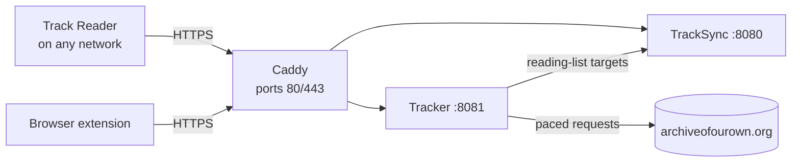

# Ao3Track 2 — Setup & Remote Access Guide

## Overview

You'll run two small servers in Docker on one machine. Your devices then sync through them, at home and anywhere else via your own domain. Setup takes about 30 minutes, plus 15 more for remote access.

| Piece | Runs on | What it does | Address you'll use |
| --- | --- | --- | --- |
| TrackSync | Docker | Your account, sync between devices, web dashboard | `http://localhost:8080` at home, `https://sync.yourdomain.com` remotely |
| Tracker | Docker | The only thing that talks to AO3 in the background; paces requests and caches work info | `http://localhost:8081`, `https://tracker.yourdomain.com` |
| Archive Track Reader | Your Windows PC | The reading app (MSI installer) | — |
| Browser extension | Chrome, Edge or Firefox | Same tracking inside your normal browser | — |



The diagram shows the finished setup. Caddy is a web server you'll add in Part 5; it gets free HTTPS certificates for your domain and forwards traffic to the two containers.

What you need:

- A PC or home server that stays on, with Docker installed (Docker Desktop on Windows is fine).
- This repository (*Code → Download ZIP*, or `git clone`), plus `ArchiveTrackReader-2.2.2-x64.msi` and `ao3track-extension-2.2.2.zip` from the [Releases](https://github.com/mbols2510/AO3-track-reader-V2/releases) page.
- For remote access: your domain, access to its DNS settings, and access to your router's port-forwarding page.

## Part 1: Run the servers

One command starts both containers once a `.env` file exists. Do this on the machine that will stay on.

1. Install [Docker Desktop](https://www.docker.com/products/docker-desktop/) (Windows or Mac) or Docker Engine (Linux). On Windows, accept the WSL 2 option it offers, then restart.
2. Put the repository somewhere permanent, for example `C:\ao3track`. Open a terminal in that folder.
3. Create your settings file by copying the template:
   - Windows: `copy .env.example .env`
   - Mac/Linux: `cp .env.example .env`
4. Generate a random secret for `INTERNAL_TOKEN`. In PowerShell 7 run `[Convert]::ToHexString([Security.Cryptography.RandomNumberGenerator]::GetBytes(32))`; on Mac/Linux run `openssl rand -hex 32`. Paste the result into `.env` after `INTERNAL_TOKEN=`.
5. Let Docker download the ready-made images. The repository is private, so its images are too, and Docker needs to sign in to GitHub's image registry once:
   - On GitHub: your picture → *Settings* → *Developer settings* → *Personal access tokens* → **Tokens (classic)** → *Generate new token (classic)*. Tick only **read:packages** and choose an expiry. (GitHub's image registry doesn't accept fine-grained tokens.)
   - Run `docker login ghcr.io -u mbols2510` and paste that token as the password. Docker remembers it.
6. Start everything: `docker compose up -d`. The first download takes a minute or two.
   Prefer to build from the source code instead? Use `docker compose -f docker-compose.yml -f docker-compose.build.yml up -d --build` (2–5 minutes).
7. Check both show `healthy`: `docker compose ps`.
8. Open **http://localhost:8080**, click *Create account*, and pick a username and password. This is your new account; it doesn't need to match your old one.

The tracker's status page is **http://localhost:8081/api/status**. It shows how many works are cached and whether AO3 has asked it to pause.

The defaults in `.env` are safe to leave alone. The ones worth knowing:

| Setting | Default | Change it when |
| --- | --- | --- |
| `BIND_ADDRESS` | `127.0.0.1` | Set `0.0.0.0` to reach the servers from other devices on your home Wi-Fi |
| `ALLOW_REGISTRATION` | `true` | Set `false` once your account exists (required before going public in Part 5) |
| `AO3TRACK_VERSION` | `latest` | Pin a version (e.g. `2.2.2`) if you don't want to follow every release |
| `REFRESH_INTERVAL_HOURS` | `6` | How often the tracker checks your reading list for new chapters (even while the reader is closed) |
| `GITHUB_TOKEN` | empty | Only needed while the repository is private, so the desktop reader can find new versions (see below) |
| `RATE_REFILL_SECONDS` | `12` | Seconds between AO3 requests; raising it is gentler, lowering it is not recommended |

**Reader updates.** The desktop reader asks your tracker whether a new version exists, and the tracker asks GitHub. While the repository is private, the tracker needs a read-only token: on GitHub, *Settings* → *Developer settings* → *Personal access tokens* → *Fine-grained tokens* → *Generate new token*, choose **Only select repositories** → this repository, and under *Repository permissions* set **Contents: Read-only**. Paste it into `.env` after `GITHUB_TOKEN=`. The reader then checks shortly after it starts (and via *Settings → Check for updates*), and offers *Install now*, *Later* or *Skip this version*.

After editing `.env`, apply it with `docker compose up -d`. If something doesn't start, `docker compose logs tracksync` or `docker compose logs tracker` shows why.

## Part 2: Bring your data over

The dashboard copies everything from your old cloud account in one click. Nothing on the old service is changed, and you can repeat it safely: existing items are kept, and a reading position only ever moves forward.

1. Signed in at **http://localhost:8080**, find the card *Bring your data over*.
2. Enter the username and password from the original Archive Track Reader.
3. Click *Migrate from original service*. It reports how many reading positions, reading-list entries and filters it found and imported.

The stat cards at the top then show your totals. Your other devices receive the data at their next sync.

**If the old service is offline or rejects your login**, import the old Windows app's local database instead. It holds the same data, as of the last time that app synced.

1. Close the old Archive Track Reader app.
2. In File Explorer, open `%LOCALAPPDATA%\Packages`. Open the folder whose name contains *Ao3Track* or *ArchiveTrack*, then `LocalState`.
3. Copy `Ao3TrackSQLite.db3` to your desktop.
4. In the dashboard, use *Import the old app's database*, choose that file, and click *Import database file*.

From a terminal, the same imports work with the admin tool:

- `docker compose exec tracksync node cli.js migrate <new-user> <old-user> <old-password>`
- `docker compose cp Ao3TrackSQLite.db3 tracksync:/tmp/old.db3`, then `docker compose exec tracksync node cli.js import-legacy-db <new-user> /tmp/old.db3`

## Part 3: Install the Track Reader

The MSI installs the new reader for all users, with Start Menu and desktop shortcuts. It sits alongside the old Store app rather than replacing it.

1. Double-click `ArchiveTrackReader-2.2.2-x64.msi`. The installer isn't code-signed, so Windows shows *Windows protected your PC*: click *More info*, then *Run anyway*. Approve the admin prompt.
2. Launch *Archive Track Reader*. The Settings pane opens on first run.
3. Under **Sync**, enter `http://localhost:8080` plus the account from Part 1, and click *Sign in*. Your migrated reading list fills the sidebar within a few seconds.
4. Under **Tracker service**, enter `http://localhost:8081` and click *Test*. Leave *API key* empty for now; you'll fill it in Part 5.
5. Sign in to AO3 inside the reader (the normal AO3 login link) if you read works restricted to logged-in users.

If the servers run on a different machine at home, use that machine's address instead of `localhost`, and set `BIND_ADDRESS=0.0.0.0` in its `.env`.

**Retiring the old Store app.** Windows only lets the original publisher update that package, so it can't be upgraded in place. Once the new reader shows your reading list and positions, uninstall the old one from *Settings → Apps → Installed apps*. Keep a copy of `Ao3TrackSQLite.db3` first (Part 2, steps 1–3) in case you want to re-import later.

Future versions of the new reader do upgrade in place: running a newer MSI replaces the installed one and keeps your data. That data lives in `%APPDATA%\Archive Track Reader`.

## Part 4: Install the browser extension (optional)

The extension tracks your place when you read AO3 in a normal browser, and syncs with the reader. Download `ao3track-extension-2.2.2.zip` from the Releases page; your tracker also serves it at **http://localhost:8081/downloads/**.

1. Unzip it to a folder you'll keep, for example `C:\ao3track\extension`. The browser loads it from there, so don't delete it.
2. Load it:
   - **Chrome or Edge:** open `chrome://extensions` (or `edge://extensions`), turn on *Developer mode*, click *Load unpacked*, and choose the folder.
   - **Firefox:** open `about:debugging#/runtime/this-firefox`, click *Load Temporary Add-on*, and pick `manifest.json`. Firefox removes it on restart unless it's signed through addons.mozilla.org.
3. Click the extension's toolbar icon, enter your server (`http://localhost:8080` now, your domain after Part 5) and your account, then click *Sign in*.
4. Allow the permission prompt. It lets the extension contact that one server address.

On AO3 you'll see a *Continue reading* button, a reading-list button, and unread badges on works lists. Right-click any tag or author link for *Hide works matching this link*.

## Part 5: Reach it from anywhere with your domain

You'll put both servers behind two HTTPS subdomains, `sync.yourdomain.com` and `tracker.yourdomain.com`. The included Caddy container gets free Let's Encrypt certificates and renews them automatically. Replace `yourdomain.com` with your domain throughout.

There are two routes. Use **Option A** if your router can forward ports; it takes about 15 minutes. Use **Option B** (Cloudflare Tunnel) if you can't forward ports, which is common with carrier-grade NAT or some fibre ISPs. You're behind CGNAT if your router's WAN IP differs from the one shown at [ifconfig.me](https://ifconfig.me), or starts with `100.64`–`100.127`.

### Lock it down first

Make these three changes in `.env` before anything is reachable from the internet:

1. `ALLOW_REGISTRATION=false`, so strangers can't create accounts on your server.
2. `TRACKER_API_KEY=` followed by a new random value (`openssl rand -hex 24`, or the PowerShell command from Part 1). Without it, anyone could make your tracker send requests to AO3 and use up your IP's allowance.
3. Your TrackSync account has a long, unique password. Change it in the dashboard if needed.

What's reachable once you're online:

| Address | Protected by |
| --- | --- |
| `https://sync.yourdomain.com` (dashboard + sync API) | Your password; each device gets its own token; 8 failed logins triggers a lockout |
| `https://sync.yourdomain.com/internal/*` | Blocked by Caddy; also needs `INTERNAL_TOKEN` |
| `https://tracker.yourdomain.com/api/*` | `TRACKER_API_KEY` |
| `https://tracker.yourdomain.com/downloads/`, `/healthz` | Public: only the extension zip and a health check |

### Option A: Caddy with port forwarding

1. **Fix the server's home address.** In your router, give the server a DHCP reservation so its LAN IP never changes (for example `192.168.1.50`).
2. **Forward ports.** In the router's port-forwarding page, forward TCP `80` and TCP `443` to that IP. Also forward UDP `443` if offered; it's optional. Port 80 is needed for Let's Encrypt's check, and Caddy redirects it to HTTPS.
3. **Create DNS records** at your domain's DNS provider, pointing at your public IP from [ifconfig.me](https://ifconfig.me):

   | Type | Name | Value | Notes |
   | --- | --- | --- | --- |
   | A | `sync` | your public IPv4 | If your DNS is on Cloudflare, set *DNS only* (grey cloud) |
   | A | `tracker` | your public IPv4 | Same |

4. **Fill in the remote-access section of `.env`:** `SYNC_DOMAIN=sync.yourdomain.com`, `TRACKER_DOMAIN=tracker.yourdomain.com`, `ACME_EMAIL=` your email (Let's Encrypt only uses it for expiry warnings), and the `TRACKER_API_KEY` from above.
5. **Start with the Caddy overlay:**

   ```
   docker compose -f docker-compose.yml -f docker-compose.caddy.yml up -d
   ```

6. **Check the certificates.** Run `docker compose -f docker-compose.yml -f docker-compose.caddy.yml logs caddy` and look for *certificate obtained successfully* for both names. If you instead see a timeout, port 80 isn't reaching the machine; recheck step 2 and the firewall note below.
7. **Test from outside.** Turn off Wi-Fi on your phone and open `https://sync.yourdomain.com`. You should see the dashboard with a valid padlock.

**Windows firewall:** Docker Desktop normally allows ports 80 and 443 itself. If the phone test fails, add inbound rules for TCP 80 and 443 in *Windows Defender Firewall → Advanced settings*.

**Home IP changes:** most home connections get a new public IP now and then, which breaks the A records. Use your registrar's dynamic-DNS feature, or run a DDNS updater such as [ddns-updater](https://github.com/qdm12/ddns-updater) to keep the records current.

### Option B: Cloudflare Tunnel (no port forwarding)

The `cloudflared` container dials out to Cloudflare, and Cloudflare serves your subdomains over HTTPS. Your domain's DNS must be managed by Cloudflare; the free plan is enough.

1. In the Cloudflare dashboard, go to *Zero Trust → Networks → Tunnels → Create a tunnel*, choose *Cloudflared*, and name it `ao3track`.
2. Copy the tunnel token it shows (the long string after `--token`) into `.env` as `CLOUDFLARE_TUNNEL_TOKEN=`. Also set `SYNC_DOMAIN`, `TRACKER_DOMAIN` and `TRACKER_API_KEY`.
3. On the tunnel's *Public Hostname* tab, add two hostnames:
   - `sync.yourdomain.com` → service type `HTTP`, URL `tracksync:8080`
   - `tracker.yourdomain.com` → service type `HTTP`, URL `tracker:8081`
4. Start with the tunnel overlay:

   ```
   docker compose -f docker-compose.yml -f docker-compose.tunnel.yml up -d
   ```

5. Under *Security → Bots* for your domain, make sure *Bot Fight Mode* is off, or add a skip rule for these two hostnames. The reader and extension aren't web browsers, so a Cloudflare challenge page would silently break syncing.

### Reconnect your apps to the domain

In the **Track Reader**, open Settings:

1. Under Sync, click *Sign out*, then sign in with `https://sync.yourdomain.com` and the same account. Nothing is lost; the reader merges with the server on sign-in.
2. Under Tracker service, enter `https://tracker.yourdomain.com`, paste your `TRACKER_API_KEY` into *API key*, and click *Test*. It should say *Connected*.

In the **browser extension**, sign out and sign back in with `https://sync.yourdomain.com`, and accept the new permission prompt.

**Using the domain at home too.** Keep the apps on the domain address everywhere, so you never switch settings. Most routers route this correctly from inside the house. If the domain doesn't load at home but does on mobile data, your router lacks *NAT loopback*. Fix it on each home PC by adding lines like these to `C:\Windows\System32\drivers\etc\hosts`, using the server's LAN IP:

```
192.168.1.50  sync.yourdomain.com
192.168.1.50  tracker.yourdomain.com
```

The certificate stays valid because the name is unchanged. (Option B doesn't need this.)

Your AO3 request budget is unaffected: the tracker still runs at home and uses your home IP, whichever network your reader is on.

## Part 6: Backups, updates and troubleshooting

All your sync data is one SQLite file in the `tracksync-data` Docker volume; back that up and you can rebuild everything else. The tracker's cache can always be refetched, so it needs no backup.

**Backups.** Pick one:

- Quick, per account: the dashboard's *Download backup* button, or `docker compose exec tracksync node cli.js export <user> > backup.json`. Restore with *Restore from backup* in the dashboard; it merges and never deletes.
- Whole server: stop TrackSync briefly so the database file is consistent, then archive the volume:

```
docker compose stop tracksync
docker run --rm -v ao3track_tracksync-data:/data -v "${PWD}:/backup" alpine tar czf /backup/tracksync-backup.tgz -C /data .
docker compose start tracksync
```

**Updating.** With `AO3TRACK_VERSION=latest` (the default), run `docker compose pull` and then `docker compose up -d`, adding the same `-f` overlay files you normally use. Data volumes are untouched. If you build from source, update the folder (`git pull`) and re-run your `--build` command instead. For the reader, accept the update prompt, or run the newer MSI yourself; it replaces the old version in place.

**Admin commands** (add the same `-f` flags if you started with an overlay):

| Task | Command |
| --- | --- |
| List accounts | `docker compose exec tracksync node cli.js users` |
| Reset a forgotten password (signs out all devices) | `docker compose exec tracksync node cli.js reset-password <user> <new-password>` |
| Create an account while registration is off | `docker compose exec tracksync node cli.js create-user <user> <password>` |
| Check the tracker and AO3 pause state | open `/api/status` on the tracker, with your API key if set |

**Troubleshooting**

| Symptom | Likely cause | Fix |
| --- | --- | --- |
| `docker compose up` stops with *Set INTERNAL_TOKEN in .env* | `.env` missing or the value is empty | Part 1, steps 3–4 |
| Reader says *Couldn't reach the sync server* | Wrong address, or container down | Open the same address in a browser; run `docker compose ps` |
| `unable to open database file` / `Cannot create or open the database` | Container can't write its data folder (usually a bind-mounted NAS folder) | Set `PUID`/`PGID` in `.env` to the folder owner's IDs (`id <user>` over SSH), then `docker compose up -d` |
| Works at home, not on mobile data | Port forwarding or DNS | Part 5, Option A steps 2–3; confirm `nslookup sync.yourdomain.com` returns your public IP |
| Works on mobile data, not at home | Router lacks NAT loopback | Add the `hosts` lines from Part 5 |
| Caddy log shows certificate errors | Port 80 not reaching Caddy, or DNS not yet updated | Recheck forwarding; wait up to an hour for DNS, then restart Caddy |
| Tracker *Test* says *wrong or missing API key* | Key in the reader doesn't match `TRACKER_API_KEY` | Copy the value from `.env` again, without spaces |
| Reading list says *Updates paused by AO3* | AO3 rate-limited your home IP | Nothing: it resumes automatically (after at least 5 minutes). If frequent, raise `RATE_REFILL_SECONDS` |
| `docker compose pull` says *denied* or *unauthorized* | Docker isn't signed in to ghcr.io, or the token lacks `read:packages` | Part 1, step 5 |
| *Check for updates* says the tracker isn't set up | `GITHUB_REPO` is empty in `.env`, or the repository is private and `GITHUB_TOKEN` is missing | See *Reader updates* in Part 1, then `docker compose up -d` |
| Extension won't sign in | Permission prompt was dismissed | Remove and re-add the extension, then sign in again and allow the prompt |
| Syncing stopped after a password change | Changing the password signs every device out, by design | Sign in again on each device |
